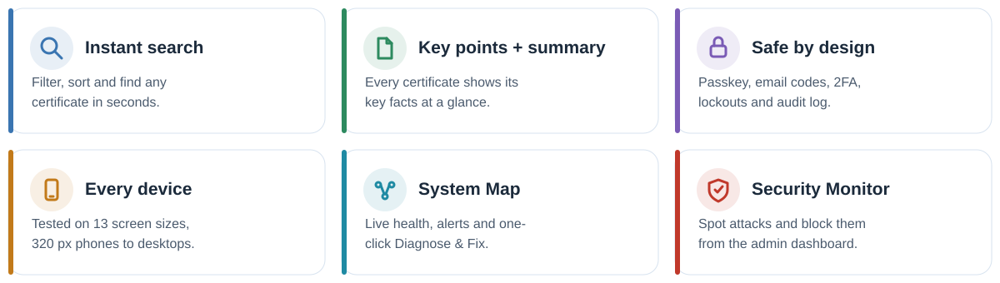
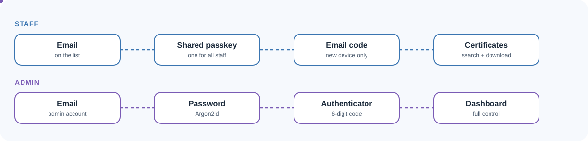
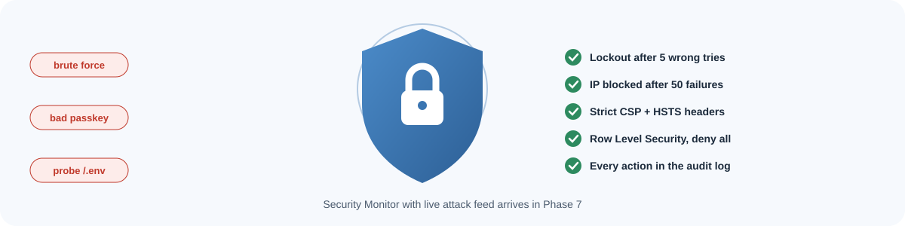
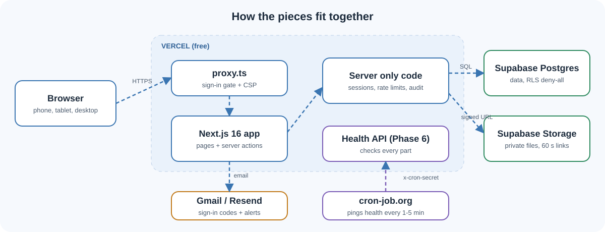
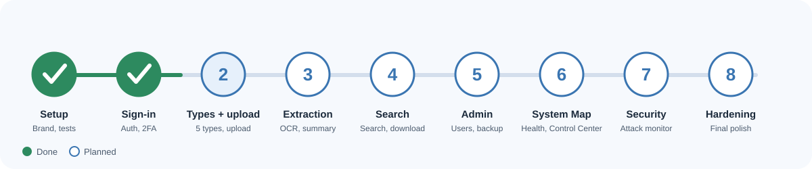

<div align="center">


<br/>


</div>

## ✨ Features



## 🔐 Sign-in



## 🛡️ Security



## 🧩 Architecture



## 🚀 Setup



```bash
pnpm install
cp .env.example .env.local   # fill in the values
pnpm db:migrate
pnpm dev
```

## 🗺️ Roadmap



<div align="center">

**© 2026 orava (Pvt) Ltd.** · Developed by **Shehan Nirmana**

</div>
