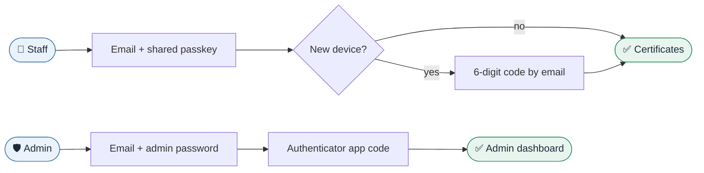

<div align="center">


<br />


<br /><br />

**[Features](#-features)** &nbsp;·&nbsp; **[How it fits together](#-how-it-fits-together)** &nbsp;·&nbsp; **[Quick start](#-quick-start)** &nbsp;·&nbsp; **[First-time setup](#-first-time-setup)** &nbsp;·&nbsp; **[Sign-in](#-how-sign-in-works)** &nbsp;·&nbsp; **[Testing](#-testing)** &nbsp;·&nbsp; **[Roadmap](#-roadmap)**

</div>

<br />

> [!NOTE]
> **Status: Phase 1 of 8 done.** Sign-in, the admin account and staff management work today. Certificate upload,
> search and the monitoring pages arrive in the next phases (see the [roadmap](#-roadmap)).

## ✨ Features


<br />

| 👥 For permitted staff                      | 🛠️ For the admin                                             |
| ------------------------------------------- | ------------------------------------------------------------ |
| Sign in with company email + shared passkey | Upload a PDF and/or scanned image per certificate            |
| Instant search, filters and sorting         | Automatic key points and summary on upload                   |
| Key points and summary on every certificate | Certificate types you can add or edit any time               |
| In-browser PDF and image preview            | Full control of users and certificates                       |
| Download the PDF, the image, or both        | Live **System Map** with alerts and one-click Diagnose & Fix |
| Works on every phone, tablet and desktop    | **Security Monitor** for attacks and defenses                |

> Full plan, including what is and is not possible on free tiers: [`PLAN.md`](PLAN.md)

## 🧩 How it fits together


<details>
<summary><b>🧰 Tech stack</b> (all free, all latest stable)</summary>

<br />

| Layer     | Technology                                                                                                        |
| --------- | ----------------------------------------------------------------------------------------------------------------- |
| Framework | Next.js 16 (App Router), React 19, TypeScript 7                                                                   |
| UI        | Tailwind CSS 4, shadcn/ui-style components (Radix UI), lucide icons, Geist font                                   |
| Data      | Supabase Postgres (server-side `postgres` driver), Storage and Realtime (free tier)                               |
| Auth      | Email allowlist + shared passkey (Argon2id), email code on new devices, admin password + authenticator app (TOTP) |
| Email     | Gmail SMTP app password or Resend (both free)                                                                     |
| Testing   | Vitest (unit), Playwright + axe-core (responsive, accessibility, sign-in flows)                                   |
| Quality   | ESLint 10, Prettier 3, EditorConfig, GitHub Actions CI, Dependabot                                                |
| Hosting   | Vercel (Hobby)                                                                                                    |

> **TypeScript note:** TypeScript 7 (the native compiler) runs `pnpm typecheck`. Tools that still need the
> TypeScript 6 API (ESLint, Next.js build checks) use `@typescript/typescript6` under the `typescript`
> name, as Microsoft recommends for running both side by side.

</details>

<details>
<summary><b>📁 Project structure</b></summary>

<br />

```text
src/
  app/                 Routes: sign-in, /verify, /certificates, /admin/*
  components/
    admin/             Admin navigation and forms
    auth/              Sign-in, code and setup forms
    forms/             Field, password input, submit button
    layout/            Header, footer, skip link
    ui/                shadcn/ui-style components
  lib/
    auth/, admin/      Server actions
    server/            Database, sessions, rate limits, email, audit (server only)
  proxy.ts             Per-request Content-Security-Policy and sign-in gate
supabase/migrations/   SQL schema with deny-all Row Level Security
scripts/db-migrate.ts  Migration runner
docs/images/           README graphics (SVG)
tests/
  e2e/                 Playwright: sign-in flows + responsive and accessibility checks
  unit/                Vitest unit tests
public/                Logo and app icons
PLAN.md                Full build plan
```

</details>

## 🚀 Quick start

**You need:** Node.js 26 LTS (see `.nvmrc`; 22.12+ works) and pnpm 12.

```bash
corepack enable                          # 1. enable pnpm (ships with Node.js)
pnpm install                             # 2. install dependencies
cp .env.example .env.local               # 3. create your env file (PowerShell: Copy-Item .env.example .env.local)
pnpm db:migrate                          # 4. create the tables (after filling .env.local, see below)
pnpm dev                                 # 5. start the dev server
```

Open <http://localhost:3000>. Without email settings, sign-in codes print in the terminal during development.

## 🛠️ First-time setup

Do this once. Everything is free.

| #   | Step               | What to do                                                                                                                                                                                |
| --- | ------------------ | ----------------------------------------------------------------------------------------------------------------------------------------------------------------------------------------- |
| 1   | 🗄️ **Supabase**    | Create a free project at <https://supabase.com> (region: Singapore) with a strong database password. Open _Connect → Transaction pooler_ and copy the string into `DATABASE_URL`.         |
| 2   | 🔑 **Secrets**     | Make `AUTH_SECRET` and `ADMIN_SETUP_TOKEN` (run the command below twice, one value each).                                                                                                 |
| 3   | ✉️ **Email codes** | In your Google account turn on 2-Step Verification, create an [App password](https://myaccount.google.com/apppasswords) and put it in `SMTP_APP_PASSWORD`.                                |
| 4   | 🧱 **Tables**      | `pnpm db:migrate` (or paste `supabase/migrations/*.sql` into the Supabase SQL editor, in order).                                                                                          |
| 5   | ▲ **Vercel**       | Add every variable from `.env.local` under _Project → Settings → Environment Variables_, then redeploy.                                                                                   |
| 6   | 👤 **Admin**       | Open `/admin/setup`, enter the setup token, choose your admin password and the shared staff passkey, and scan the QR code with an authenticator app. The page closes for good afterwards. |
| 7   | 👥 **Staff**       | In _Admin → Staff_, add each permitted email and give them the shared passkey.                                                                                                            |

```bash
node -e "console.log(require('crypto').randomBytes(48).toString('base64url'))"
```

## 🔐 How sign-in works



| Who       | Steps                                                                                                                       |
| --------- | --------------------------------------------------------------------------------------------------------------------------- |
| **Staff** | Email (must be on the list) + shared passkey. A new device also needs a code sent by email, then it is trusted for 30 days. |
| **Admin** | `/admin/login`: email + admin password, then an authenticator code. Admin sessions last 8 hours.                            |

**Protection built in**

| 🔒 Lockouts                                          | 🚫 Blocking                                 | 📜 Audit                                 | 🚨 Emergency                                        |
| ---------------------------------------------------- | ------------------------------------------- | ---------------------------------------- | --------------------------------------------------- |
| 5 wrong tries lock an email for 15 min (10 → 1 hour) | An IP is blocked for 24 h after 50 failures | Every sign-in and admin action is logged | Change the passkey or turn on lockdown in one click |

## 🧪 Testing

The tests start their own throwaway Postgres (PGlite, in memory) with test accounts, so they never touch your real data.

| Command                             | What it does                                                                 |
| ----------------------------------- | ---------------------------------------------------------------------------- |
| `pnpm dev`                          | Start the development server                                                 |
| `pnpm build` / `pnpm start`         | Production build / serve it                                                  |
| `pnpm check`                        | Lint, typecheck, format check and unit tests in one go                       |
| `pnpm test`                         | Unit tests (Vitest)                                                          |
| `pnpm test:e2e`                     | Sign-in flows + responsive and accessibility checks (run `pnpm build` first) |
| `pnpm test:e2e:all`                 | Same, plus Safari (WebKit) and Firefox                                       |
| `pnpm lint` / `pnpm typecheck`      | ESLint / TypeScript 7                                                        |
| `pnpm format` / `pnpm format:check` | Prettier with Tailwind class sorting                                         |
| `pnpm db:migrate`                   | Apply new database migrations (reads `DATABASE_URL` from `.env.local`)       |

<details>
<summary><b>📱 Responsive checks: 13 screen sizes, every page</b></summary>

<br />

Responsiveness is a hard requirement. Every page in `tests/e2e/pages.ts` is checked, signed in where needed:

| Device      | Sizes tested                                                   |
| ----------- | -------------------------------------------------------------- |
| 📱 Phones   | 320, 360, 375, 390, 412, 430 px wide, plus 844 × 390 landscape |
| 📲 Tablets  | 768, 820 px portrait and 1024 × 768 landscape                  |
| 💻 Desktops | 1280, 1440 and 1920 px                                         |

Each page must have: no sideways scrolling · nothing sticking out past the screen edge · every button, field and link at least 44 × 44 px · WCAG 2.2 AA accessibility (axe-core) · a white background · a full-page screenshot for review.

</details>

## 🗺️ Roadmap


## 🛡️ Security

- Never commit `.env*` files or real certificates (`/samples` and `/private` are git-ignored).
- Strict security headers (nonce-based CSP, HSTS, no framing) and the site is hidden from search engines.
- The browser never receives database keys. Every table has Row Level Security on with no public access.
- Passkey, passwords and codes are stored only as Argon2id or keyed hashes. The authenticator secret is encrypted (AES-256-GCM).
- Report security issues privately to the admin, not in public issues.

## 📝 Credits and licence

<table>
  <tr>
    <td><b>Developer</b></td><td>Shehan Nirmana</td>
    <td><b>Company</b></td><td>orava (Pvt) Ltd.</td>
    <td><b>Version</b></td><td>0.2.0</td>
  </tr>
</table>

© 2026 orava (Pvt) Ltd. All rights reserved. Proprietary and confidential; see [`LICENSE`](LICENSE).
